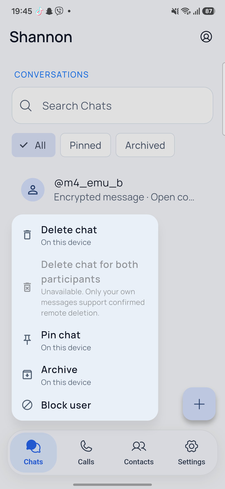

# Reaction stability, chat actions and message selection — 2026-10-29

Implemented in the existing uncommitted repository state and installed only as
`dev.shannon.shannon.validation` on Samsung A54 and the retained Android Emulator.
No normal-app install, data clear, identity regeneration, PostgreSQL reset,
commit or push. Earlier M4/UI work and APK artifacts remain intact.

## Fixed reaction crash and delay

- The floating menu previously called `findRenderObject()` from its overlay
  layout. A history update could deactivate the original bubble before that
  lookup. The menu now snapshots its anchor rectangle synchronously while the
  tapped element is active and never re-queries that element during overlay builds.
- Existing-session reactions now encrypt/commit to the native outbox locally
  before network directory work. A fresh pinned-key check still gates every
  transport batch **before transmission**; identity-change rejection is preserved.
  First-session setup can still require an online prekey exchange.
- A newly queued action arriving during an active synchronization schedules an
  immediate subsequent pass rather than waiting for another hint/retry tick.
  Successful full outbox pages also drain onward; network failures retain backoff.
- Empty sync polls no longer force history reloads. Committed incoming changes
  paint before transport acknowledgment requests finish. During an actual reload,
  existing bubbles, scroll state, recipient metadata and pin previews are retained.
  Lock/background/not-ready gates still hide private content.
- Reaction dispatch does not wait for the menu closing animation. Own reaction
  tooltips distinguish local queued, waiting and recipient-confirmed states.

This removes the artificial network wait from local feedback. It does not promise
zero-millisecond rendering or immediate delivery to an offline recipient.

## Chats long press

| Action | Behavior |
|---|---|
| Delete chat | Local logical history deletion/hiding; retains identity, contact, session/ratchet and durable dedup records. Confirmation explains that peer copies remain and previously queued messages can still deliver. New text can reopen the chat. |
| Delete chat for both participants | Visibly disabled with explanation. Current shared deletion authorizes only the original sender's individual messages; there is no authenticated bilateral whole-history-erasure capability. No fake remote operation. |
| Pin / Unpin chat | Encrypted on-device preference; pinned chats sort first and are available under Pinned. Separate from contact pinning. |
| Archive / Unarchive | Encrypted on-device preference; archived chats are available under Archived and stay archived until explicitly restored. |
| Block user | Existing authenticated backend block, with confirmation; saved history/keys remain. Unblock path remains in Contact privacy. |

All/Pinned/Archived filters are now available for real M4 chats. New flags are
inside the existing encrypted peer record; no key or database replacement.

## Message long press and selection

Long press enters selection immediately. Tap additional messages to select or
deselect; the toolbar shows the count, Forward and Delete. Android Back or Close
exits selection without leaving the conversation. Single tap still opens the
reaction/action menu, which also offers Select messages.

- Up to 100 messages per selection.
- Forward confirms a real eligible destination and queues separate fresh
  encrypted copies in original local chronological order. A partial failure
  retains its completed count so retry within that selector continues with the
  remaining messages. No original sender identity is included.
- Delete uses the existing mutually exclusive two-checkbox dialog, now with the
  selected count. Shared deletion is disabled for mixed ownership/deleted items
  or unsupported peers. Local bulk deletion commits atomically. Shared deletion
  atomically queues the encrypted events locally; remote application/acknowledgment
  remains **per message**, not an all-or-nothing distributed transaction.
- Whole-chat local deletion and bulk deletion never reset cryptographic state.
  Logical deletion is not secure flash erasure or recall of external copies.

## Results

| Check | Result |
|---|---|
| Flutter analysis | PASS: no issues. |
| Default Flutter suite | PASS: 136 tests, one deliberately gated test skipped. |
| Enabled-M4 route/privacy + chat-list actions | PASS: two additional configured executions (chat-list test is also in the default suite). |
| Inactive anchor reproduction | PASS: remove the tapped element while its menu is open, then change overlay/keyboard layout; no inactive-element/render-object error. |
| Network-independent local reaction | PASS: deliberately stall directory lookup; local queue completes within the test's 500 ms deadline, and no ciphertext is submitted before directory validation. This is a controlled regression test, not a phone frame-latency benchmark. |
| No-refresh regression | PASS: hold native history and peer reads pending; the same bubble element remains mounted, no spinner replaces history, and recipient name remains stable. |
| Selection/forward/delete widget flows | PASS: long press, count, multi-selection, mixed-ownership restriction, local scope and chronological forwarding after recipient confirmation. |
| Native Android integration + isolated PostgreSQL | PASS: complete original suite plus atomic batch ownership rollback, confirmed multi-delete, local bulk delete, persistent chat pin/archive, chat deletion/reopen with same ratchet, identity-change latch and encrypted-at-rest checks. 57 receive calls and 27 history calls exercised. |
| Go tests and vet | PASS against a fresh isolated PostgreSQL cluster during native integration. No backend functional change was needed for this fix. |
| Android app unit tests | PASS: three policy tests; final native source compiled. |
| Rust | PASS: five tests in each of three final repeated runs, after the test-only ordering fix described below. |
| Samsung Chats long press | PASS: requested menu, explicit unavailable shared-chat scope, pin, archive and unarchive. Temporary test pins were removed and the chat restored to All. |
| Real two-device selection | PASS: two new synthetic messages selected, forwarded in order and received on Samsung. Count-aware Delete for everyone produced two recipient-confirmed tombstones. |
| Real Delete for me | PASS: deleting only the two new source messages from emulator left Samsung's source copies intact. Earlier manual history was not cleared. Whole-chat deletion was exercised on isolated native test handles, not on the manual account's existing history. |
| Final APK smoke | PASS: fresh synthetic message and thumbs-up reaction visible on both devices. Current-process Flutter logs on both devices had zero matches for the reported inactive-element error or unhandled Flutter exceptions. |
| Offline feedback | PASS: Samsung history and local reaction remained available with its API reverse mapping removed; mapping was restored. Honest pending/confirmation state retained. |
| Normal preservation | PASS: saved encrypted identity-file hashes unchanged; normal installed APK unchanged; no normal M4 enrollment. Original screen timeout and keep-awake values restored from saved records. |

A repeated Rust test initially failed because two identical prekey inventories
had different map iteration order after snapshot reload. The test now sorts the
complete entries by key ID before comparing keys **and signatures**. Production
cryptographic code and the engine dependency were not changed to make it pass.

Android UI automation also occasionally returned a null hierarchy. The local
test helpers now require a fresh uniquely named successful dump before sending
input; they do not reuse a stale XML file after that tooling error.

Raw ignored evidence: `.local-test/reaction-analysis.log`, `reaction-tests.log`,
`reaction-enabled.log`, `reaction-native.log`, `reaction-android.log`,
`reaction-rust-1.log` through `reaction-rust-3.log`, validation UI dumps and
normal encrypted-file hash comparisons. Private keys were not printed/decrypted.

## Artifact and runtime

APK: `apps/mobile/build/reaction-fix/shannon-validation.apk`

SHA-256: `E3060E35CF4938134C957B1E461EAE16FD4A56919EBAD7FEDAC93664673D7412`

Both devices have this exact isolated debug APK, installed using `adb install -r`.
Manual main entry, arm64/x86_64 protocol libraries, M4 enabled only in validation.
Normal M4 remains disabled and normal APK remains
`07D34CB1A7C9ED278C1DA58FD59E6B772F054C20B0C6388FDC3A5BF569342AFB`.



The isolated loopback validation API/PostgreSQL and emulator are intentionally
left running for immediate hands-on testing with the same accounts. API is
`127.0.0.1:18080`, reached through each test device's ADB reverse mapping; normal
PostgreSQL/configuration is unchanged. The retained sandbox's temporary scoped
loopback test-role HBA rule remains active while its resume process runs.
To stop it and automatically restore its original HBA without deleting data:

```powershell
'{"operation":"stop"}' | Set-Content .local-test/m4-control.json
```

Resume later with `scripts/Resume-M4Sandbox.ps1`, without initializing/resetting
the retained database. Native App Lock continues to require the user's biometric
or device credential; no authentication bypass was added.

Full bilateral chat erasure remains unsupported. Independent security review,
normal-account M4 acceptance and production readiness remain outside these
validation passes. Existing limitations are recorded in
[the UI baseline acceptance](UI_UX_ACCEPTANCE_2026-10-29.md).
