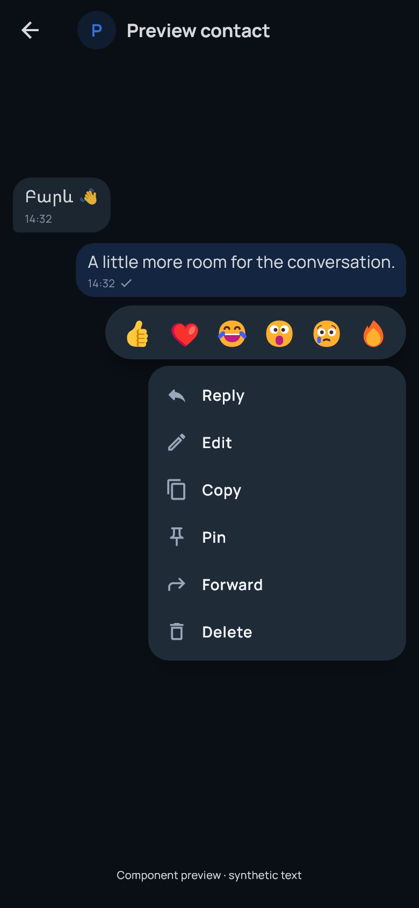
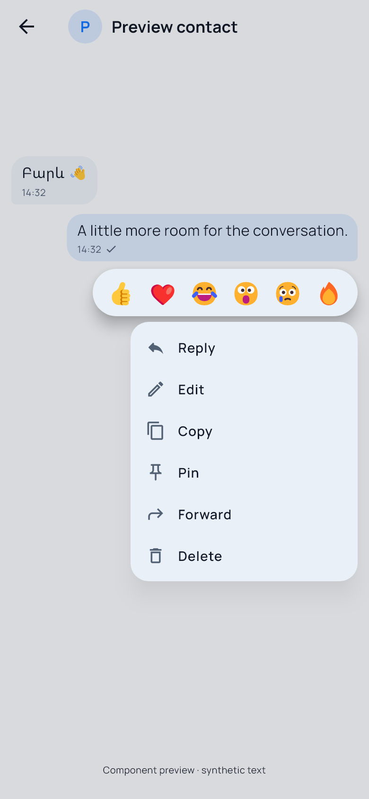
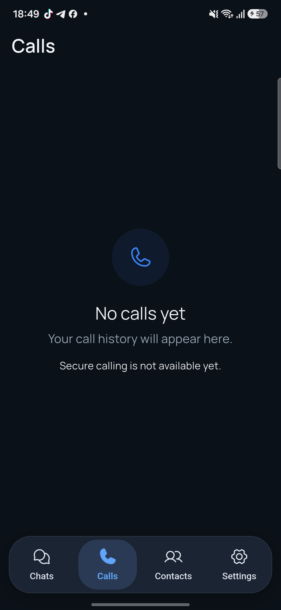
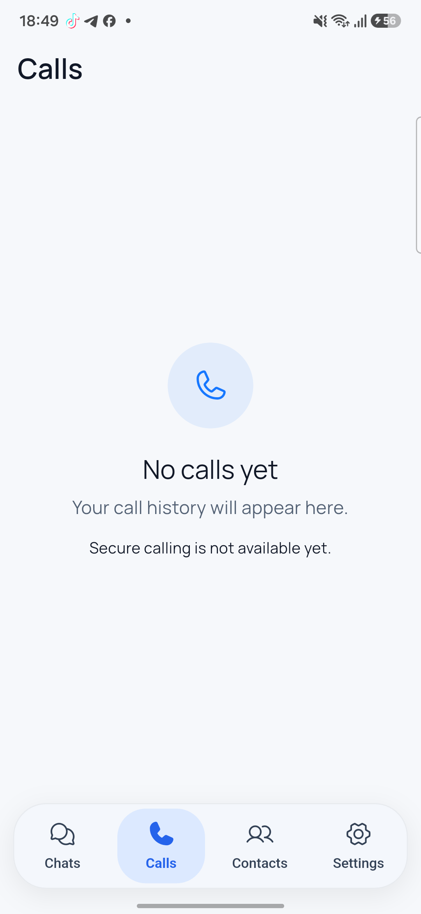

# Shannon premium UI/UX acceptance — 2026-10-29

Latest follow-up: [reaction crash/latency, chat actions and message selection](REACTION_CHAT_ACTIONS_2026-10-29.md).
It records the newer APK and current running test-service checkpoint. Results
and cleanup below describe the earlier UI baseline.

The premium UI and encrypted interactions passed isolated Samsung A54 + Android
Emulator acceptance. **The normal Samsung app was not updated, enrolled in M4,
reset or uninstalled. M4 remains disabled there.** Existing uncommitted M4 work,
identities, private keys and databases were preserved. No commit or push.
This validation milestone does not establish production-ready E2EE.

## Delivered implementation

- Native premium Unlock Shannon: ribbon/glow, dark/light palette, accessible
  Unlock action, restrained motion and existing Android biometric/credential
  verification. An opaque native cover plus independent accessibility ancestor
  hides Flutter content while permitting first-frame startup. Only native auth
  success dismisses it; native messaging/clipboard lock gates remain enforced.
- Compact content-sized directional bubbles, small timestamps/status, multilingual
  wrapping, bounded history windows, reply previews and unavailable tombstones.
- Measured floating message/contact menus, six Unicode reactions, tap/long press,
  keyboard/edge clamping, Back/outside dismissal and reduced motion. Reply/Edit
  wait for popup overlay removal before focusing the composer.
- Real encrypted reactions/change/removal, reply references, newly encrypted
  forwarding, sender-only edit/shared deletion and application acknowledgments.
  Server acceptance is distinct from recipient confirmation. Local pins and
  Delete for me persist without pretending to synchronize remotely.
- Native sensitive text-only clipboard; actual recipient name/fallback avatar,
  security details, encrypted local aliases/contact pins; real authorized
  Delete User and Block User. Fingerprint/key-change protection retained.
- Chats' “A private space” card removed and spacing reduced. Calls has a clean
  empty state with an honest secure-calling-unavailable notice.

[Encrypted application events and scope](security/M4_INTERACTION_EVENTS.md)
documents authorization, ordering, transactions and deletion limits.

## Actual acceptance results

Two existing independent validation accounts (`m4_sam_a`, `m4_emu_b`) retained
their distinct roots, devices and encryption/signing keys. Samsung is arm64;
the retained emulator is x86_64. Neither manual identity was replaced.

| Check | Actual result |
|---|---|
| Compact bubbles/menu | PASS: real component previews; short/long Armenian/Russian/English/emoji, 2× text scaling, dark/light, keyboard/edge layout tests; actual touch menus on both devices. |
| Tap/long press/dismissal | PASS: single-tap message menus, contact long press and Android Back. Outside dismissal/reduced motion also covered by widget tests. |
| Reactions | PASS: emulator heart appeared on both; changed to fire; removal propagated. Native tests also verify authenticated events and replay. |
| Reply | PASS: emulator replied to exact Samsung original; recipient saw reference/preview. Samsung quote tap navigated to correct original history window. |
| Copy | PASS: native clipboard feedback on emulator; widget test verifies only decrypted text is passed; Android sensitive flag set. Retention is disclosed. |
| Forward | PASS: real eligible selector/confirmation and new forwarded copy. Two-account acceptance targeted the existing peer conversation; native regression proves fresh ciphertext/no original-sender identity. Third-account destination untested. |
| Message pin/unpin | PASS: Samsung on-device indicator, cold-restart persistence, navigation to original, unpin. No peer pin fabricated. |
| Edit/ownership | PASS: own emulator reply changed on Samsung, edited marker and encrypted recipient confirmation. Incoming menu omits Edit; native unauthorized/out-of-order operations checked. |
| Delete for me | PASS: only emulator's new synthetic incoming copy disappeared; Samsung kept original. Reply became unavailable. Deletion survived later restart/APK replacement. |
| Delete for everyone | PASS: new forwarded copy became tombstone. With Samsung closed, sender said Waiting for recipient; ciphertext survived API restart. Unlock/reconnect produced Confirmed by recipient. |
| Checkboxes | PASS: initially none, exactly one required, mutually exclusive. Incoming shared deletion disabled/explained; recall/erasure limits visible. |
| Header/details | PASS: username/fallback avatar; local Samsung A54 name and S avatar on emulator. Header opens original verified fingerprint/details. No presence/view status. |
| Chats/Calls | PASS: actual Samsung screens and dark/light Calls screenshots; removed structures absent, chat previews contain no plaintext. |
| Pin User | PASS: long press, on-device scope, persisted emulator restart; next menu says Unpin User. |
| Block/unblock | PASS: real backend block removed accepted entry and appeared in Blocked contacts; real Unblock cleared it. Samsung discovery-off preference preserved. |
| Delete User | PASS: real removal left zero test relationships and both messaging devices present. Re-request/accept restored same pair; final relationship accepted and zero test blocks. Saved keys/history intact. |
| Final native App Lock | PASS: final cold launch/native success outcome; user confirmed new cover on reopen, cancel stays locked, fingerprint/PIN unlock and responsive Chats/Contacts/Settings. Full final timeout matrix not claimed. |
| Offline history/outbox | PASS: emulator API reverse mapping removed; cold launch offered local chats/history. New message survived offline restart/APK replacement and delivered after reconnect. |
| Persistence/trust | PASS: v1 history survives schema 2, fingerprint unchanged, new messages/actions across restarts. Native rollback/replay/persistent identity-change rejection passed. |
| Prekeys | PASS: Rust replenishment test preserves outstanding private keys/identity; actual inventories ended at 50 unclaimed prekeys each. |
| Plaintext inspection | PASS, scoped: zero known synthetic text/event marker hits in pending ciphertext and current API/PostgreSQL logs; schema stores opaque ciphertext/public keys/routing. Not proof against all possible leakage. |
| Normal preservation | PASS, scoped: installed normal APK and three encrypted identity-file hashes match saved checkpoint; no normal M4 database; no normal writes/install/reset/enrollment performed. |

The earlier real API/PostgreSQL outage and PostgreSQL-restart acceptance remains
in [M4_ANDROID_ACCEPTANCE.md](M4_ANDROID_ACCEPTANCE.md). This UI run freshly tested
API restart with pending deletion and device-side API unreachability; it does not
relabel earlier full-outage evidence as a new run.

## Final regression runs

| Run | Result |
|---|---|
| Flutter analysis | PASS: no issues. |
| Full Flutter suite | PASS: 130 passed, one intentionally gated M4 test skipped in default configuration. |
| Enabled M4 navigation/privacy test | PASS: one additional executed test with SHANNON_M4_MESSAGING=true; sensitive routes retain capture protection. |
| Menu/focus/action/preview regression | PASS: 11 tests, included in full count; exact dispatch/ownership, focus, layout and checkbox behavior. |
| Rust protocol suite | PASS: five tests: exchange/replay, tamper/restore, low-order keys/wrong wrapping key, prekey preservation, snapshot persistence. |
| Go tests/vet + PostgreSQL | PASS: fresh Test-M3Database run, then another fresh suite during final native integration. Includes contact-removal authorization/preservation. Normal database untouched. |
| Android :app:testDebugUnitTest | PASS: three LockPolicy tests, zero failures/errors, final corrected source compiled. |
| Samsung native interaction checkpoint, Oct 28 | PASS: real arm64 native case, 12 sends/43 receives/19 history calls; encrypted effects/acks, order, rollback, replay, ownership. |
| Fresh emulator native interaction, Oct 29 | PASS: same complete native case plus teardown; 12 sends/43 receives/19 history calls, identity-change latch and encrypted-at-rest scan. Separate test handles, not manual account keys. |
| Unlock preview integration | PASS: real native component rendered offscreen on Samsung, dark/light; not a protected-screen capture. |
| Manual final APK | PASS: validation ID, main entry with no integration-test binding, arm64/x86_64 protocol libraries and identical installed hashes on both devices. |

One broad `gradlew testDebugUnitTest` attempt FAILED in Flutter's integration_test
plugin JVM tests: JaCoCo did not support configured Java 25 class format 69.
Scoped Shannon `:app:testDebugUnitTest` and the real Android integration run
subsequently passed. The broad plugin run is not counted as passed.

Ignored raw evidence is under `.local-test/ux-*.log`, native JUnit XML and
validation-only UI dumps, especially `ux-analysis-final.log`, `ux-tests-final.log`,
`ux-enabled-final.log`, `ux-rust-final.log`, `ux-postgres-final.log`, `ux-native.log`,
`ux-native-final-20261029.log` and `ux-android-app-final.log`. Debug driver/VM
details are not product telemetry and should not be published as production logs.

## Issues found and fixed

- Bottom-edge menu estimated heights left a gap; position now uses measured size.
- Reply/Edit could lose focus while popup closed; overlay-removal wait and focus
  assertions now pass, with actual device input.
- An intermediate accessibility change hid Flutter before first frame and left
  Android's startup splash stuck. User reported unresponsiveness. Replaced it
  with an independent native accessibility ancestor beneath the opaque cover;
  final cold launch/auth/touch passed and user confirmed corrected flow. The
  failed intermediate APK was replaced.
- Final unused test import removed; analysis clean.

## Screenshots and previews

Menu images are real component previews with synthetic text. Unlock images are
the real native view rendered offscreen on Samsung. Conversation capture
protection was not disabled; protected plaintext screens remain uncapturable.

| Dark | Light |
|---|---|
|  |  |
|  |  |
|  |  |

[Physical Samsung cleaned Chats screenshot](previews/ui-2026-10-29/chats-dark-device.png).

## Artifact and preservation

Final APK: `apps/mobile/build/ui-refinement/shannon-ui-validation.apk`

SHA-256: `5D0A4E3B21D3B4468B9CF6D25837A070E20C14AFD410948279957A850C9FCE28`.

ID `dev.shannon.shannon.validation`; debug/manual main, validation API
`http://127.0.0.1:18080`, M4 enabled only in this isolated APK. Both devices have
this exact APK installed using `adb install -r`. Not a release-signed distribution.

Previous stable APK remains `apps/mobile/build/m4-validation/shannon-m4-validation.apk`,
SHA-256 `5DCF43DD79EC19F6312D80ABDE685D9183BD1E80CC81DB15FB9026B7048D6C54`.
Normal installed APK remains SHA-256
`07D34CB1A7C9ED278C1DA58FD59E6B772F054C20B0C6388FDC3A5BF569342AFB`.
Normal identity checks used encrypted-file hashes only, without printing or
decrypting private keys. Saved Samsung keep-awake value 0 verified/restored.
Existing PostgreSQL data/credentials were not reset.

Cleanup: owned validation API/PostgreSQL and emulator stopped; existing data and
accounts retained. The isolated PostgreSQL HBA file matches its original backup.
The final manual APK remains installed. With the test API stopped, encrypted
local history remains available and new delivery waits for reconnection. Resume
the same retained test backend from the repository root using:

```powershell
.\scripts\Resume-M4Sandbox.ps1
```

Start the retained emulator without a wipe, configure each test device with
`adb -s DEVICE reverse tcp:18080 tcp:18080`, and open Validation. Use the current
wireless ADB address. The resume script is scoped to the retained test cluster;
it does not reset normal PostgreSQL, identities or credentials.

## Limits and integration decision

Ready for controlled integration review and further isolated testing. Activation
on the normal account still needs explicit owner approval and independent review
of JNI, key binding, encrypted events/acks, persistence, dependency findings,
deletion semantics and native lock lifecycle. No production-ready E2EE claim.

The unchanged engine is vodozemac 0.11.1; its
[pinned upstream manifest](https://github.com/matrix-org/vodozemac/blob/0.11.1/Cargo.toml)
declares Apache-2.0. Original JNI avoids the AGPL Dart wrapper; locked notices
are bundled. This supports proprietary-product engineering constraints, subject
to notice/license obligations and legal review. Classical Olm v1 is not Signal
wire compatibility or post-quantum encryption; upstream audits do not cover Shannon.

Unverified/unsupported: independent security review; normal-account M4 acceptance;
full final-build App Lock timeout/lockout/OS-version matrix; human TalkBack review;
large-history/battery and prolonged concurrency/retention testing; older-client
capability interoperability; third-account forwarding; release TLS/WSS/signing;
multi-device sync/shared pins, shared profile photos, recovery/backups, groups,
media and functional voice/video calls. Logical deletion cannot guarantee secure
flash erasure or recall copied content.
